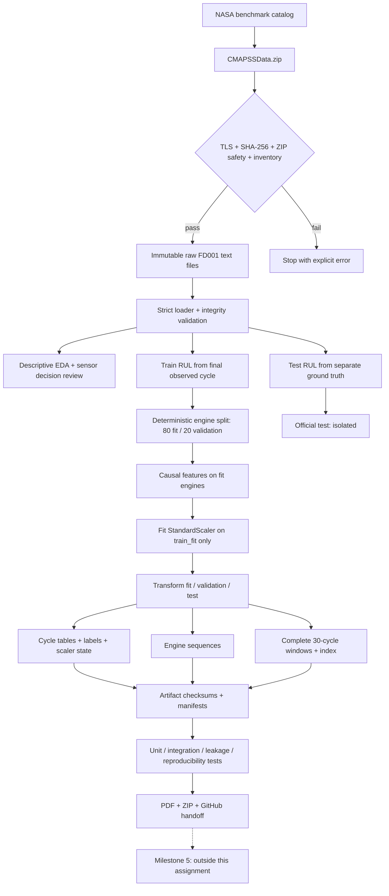
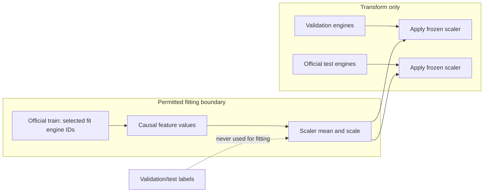

# Architecture and data flow

## Design principles
Immutable raw layer; strict contracts at boundaries; pure numerical functions where possible; configuration-driven subset/sensor/feature choices; engine-local temporal operations; explicit fit/transform separation; streaming/per-engine large-array generation; auditable metadata; no predictive training layer.

## Repository responsibilities
```text
predictive-maintenance-platform/
├── PROJECT_SPEC.md              # authoritative project specification
├── README.md                    # quick start and scope
├── LICENSE                      # license for original project code only
├── pyproject.toml / uv.lock      # dependencies, package, tooling, exact resolution
├── Makefile                     # documented command shortcuts
├── configs/                     # project, dataset, preprocessing, feature contracts
├── data/
│   ├── raw/                     # immutable NASA archive and extracted originals (local)
│   ├── interim/                 # labeled intermediate tables (generated)
│   ├── processed/               # cycle, feature, sequence, window products (generated)
│   └── metadata/                # provenance, checksums, artifact manifests
├── docs/                        # scientific decisions, contracts, guides, progress
├── notebooks/                   # reproducible EDA notebooks
├── scripts/                     # executable acquisition/validation/EDA/preprocessing/report entry points
├── src/predictive_maintenance/
│   ├── data/                    # schema, acquisition, loader, validation, labels, splitting, windows
│   ├── analysis/                # descriptive statistics and plotting
│   ├── preprocessing/           # scaler fit/transform/state persistence
│   ├── features/                # causal feature definitions and construction
│   └── reporting/               # engineering report generation
├── tests/unit/                  # arithmetic, boundaries, schemas, leakage controls
├── tests/integration/           # synthetic and real-data pipeline checks
├── reports/                     # executed validation, EDA, preprocessing, test evidence
└── .github/workflows/           # remote CI definition (not a claim of remote execution)
```

## Module boundaries
- `config.py`: YAML loading, validation, deterministic configuration fingerprints.
- `io.py`: safe paths, atomic JSON/YAML/text writes, streaming SHA-256.
- `data/schema.py`: column names, dtypes, subset catalog, feature exclusions.
- `data/acquisition.py`: HTTPS download, archive pins, safe extraction, provenance.
- `data/loader.py`: strict original text ingestion; no preprocessing.
- `data/validation.py`: independent integrity checks and structured reports.
- `data/labels.py`: train/test RUL arithmetic and independent verification.
- `data/splitting.py`: deterministic engine-level split and isolation assertions.
- `data/windows.py`: per-engine complete-window generation and metadata.
- `preprocessing/scaling.py`: training-only StandardScaler fit, JSON state, transform.
- `features/engineering.py`: engine-local causal rolling/difference/trend functions.
- `analysis/eda.py`: actual descriptive outputs; no estimator fitting.
- `reporting/engineering_report.py`: A4 PDF from verified artifacts and logs.

## End-to-end flow


## Leakage boundaries


## Memory strategy
FD001 tables are small enough for pandas. Feature calculations are per engine. Windows are generated one engine at a time using a bounded sliding-window view and saved as compressed per-engine NPZ files; no global dense window tensor is required. Sequence arrays are per engine. Tests use small synthetic fixtures; real-data tests are marked and skipped only when data are absent. The sandbox has less RAM than the user's 8 GB target, so successful execution here is a conservative memory check, not a formal peak-memory benchmark.

## Reproducibility strategy
Pin dependencies with uv; fingerprint configs and source files; sort engine IDs and feature names deterministically; record seeds, versions, shapes, dtypes, checksums, and generation timestamps. Timestamps are provenance and do not affect numerical outputs. Regeneration must reproduce numerical artifacts and manifests excluding timestamp fields. GitHub CI validates code without downloading NASA data; full local acceptance includes real-data tests.
